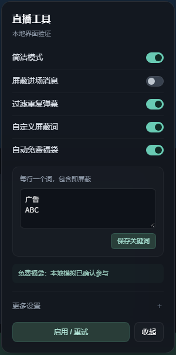

# DouyinEx

抖音网页直播间增强 Userscript：弹幕重绘、简洁模式、聊天过滤、免费福袋、画质和 PK 分数。

## 功能

- **弹幕不掉帧**：Worker + OffscreenCanvas 重绘弹幕，与主线程解耦
- **弹幕悬停**：悬停只暂停鼠标指到的那一条弹幕，同轨道其他弹幕继续滚动；可复读、+1、引用回复
- **弹幕间距**：同轨相邻弹幕的间距随机（56–206px 起步），比原生更松，且不会互相压字
- **自动最高画质**：进入直播间自动切到当前可用的最高档（原画 > 蓝光 > 超清 > 高清 > 标清）
- **屏蔽礼物特效**：调用官方「礼物设置 → 屏蔽礼物特效」
- **屏蔽送礼弹幕**：弹幕画布与右侧聊天列表都不再出现「送出了 ×N」
- **PK 真实分数**：把 `100万+` 之类的缩写替换成精确值，并实时跟随票数刷新
- **悬浮设置框**：停靠在「在线观众」旁，显示真实在线人数，点击展开设置

- **自动免费福袋**：只使用官方免费参与按钮，支持官方一键评论。自动关注单独开启；中奖弹窗保留。
- **简洁模式**：隐藏推广横幅、购物车、小时榜及礼物特效层；保留播放器控件、聊天和福袋入口，关闭后恢复。
- **进场消息过滤**：区分进场消息与普通聊天，保留“春天来了”等正常正文。
- **重复弹幕过滤**：不同用户的相同正文，10 秒内保留首条，缓存上限 1000 条。
- **自定义屏蔽词**：每行一个词，正文包含即屏蔽；按统一大小写、全角字符和空白后匹配，不执行正则。

## 安装

1. 安装 [Tampermonkey](https://www.tampermonkey.net/)
2. 打开 [DouyinEx.user.js](./DouyinEx.user.js)，点击安装
3. 进入 https://live.douyin.com/ 任意直播间

脚本自带 `@updateURL`，安装后会随仓库 `main` 分支自动更新。

## 使用

点击「弹幕增强」悬浮按钮打开“直播工具”。首页只显示五个常用开关：简洁模式、进场屏蔽、重复过滤、自定义屏蔽词、自动免费福袋。

关键词开启后展开编辑框，每行一个，点击“保存关键词”生效；最多 100 条、4000 字符。过滤同时作用于增强弹幕画布和聊天列表，已在画布上显示的旧弹幕自然滚出后消失。

“更多设置”中保留自动最高画质、礼物特效屏蔽、送礼弹幕屏蔽、PK 真实分数，以及“允许福袋自动关注”。新增开关默认关闭，原有设置继续沿用。

自动免费福袋可能触发页面上的官方一键评论。需要额外付费、加入未达成的粉丝团、分享或无法识别的条件时跳过；看播时长不足会等待复查；自动关注默认关闭。状态区区分“已点击”和“已确认参与”，中奖弹窗保留，后台隐藏页面暂停操作。

悬停任意弹幕只暂停这一条（其余弹幕照常滚动），并弹出「回复 / +1 / 复制」操作。

## 更新记录

### 2026.11.12.07

- 新增自动参与免费福袋、简洁模式、进场消息过滤、重复弹幕过滤和自定义关键词屏蔽，新增开关默认关闭。
- 菜单改为紧凑深色面板：五个常用开关直接显示，关键词编辑按需展开，原有画质、礼物、PK 和自动关注选项收在“更多设置”。
- 重复弹幕按正文归一化，10 秒内保留首条，缓存限制 1000 条；关键词按每行一个词进行字面匹配，支持 100 条 / 4000 字符。
- 免费福袋使用官方免费按钮，支持官方一键评论；未满足的付费、分享及未知条件跳过。自动关注独立选择，中奖弹窗保留；切房、关闭、离开页面会取消待执行任务。
- 59 项逻辑回归 + 16 项本地 Edge 浏览器检查通过，6000 帧弹幕模型对照一致；补丁重建和回滚哈希均已验证。尚未在真实抖音直播间或账号上实测。
- 福袋条件解析参考 Almighty-ap/DouyinEX，保留 MIT 许可及固定提交来源。

### 2026.11.12.06

- 切换直播间、退出页面或关闭自动设置时，立即取消旧房间的轮询、延迟检查和动画帧，避免旧任务继续点击。
- 开关送礼弹幕过滤时不再重复扫描画质与礼物设置；保留用户自行打开的礼物菜单。
- Worker 关闭时立即结束待决快照请求并清理定时器，关闭后请求立即返回错误。
- 本地 23 项回归全部通过，6000 帧弹幕模型对照一致。模拟连续切房 40 次时，任务峰值由 121 降至 4，退出后清零；该数据不是直播间 FPS，本次未做直播页面实测。

## 兼容性

- 仅在 `https://live.douyin.com/*` 生效
- 需要浏览器支持 `Worker` + `OffscreenCanvas`（Chrome / Edge 105+）
- 抖音页面结构变化时脚本会静默回退到原生弹幕，不影响正常观看

## 截图

简洁菜单（本地测试页面，功能状态为演示）：




## 说明

仅供个人学习与前端技术交流使用，请遵守抖音平台规则。
## 本地验证

安装 Node.js 后，在仓库根目录运行（无额外依赖）：

```sh
node tests/regression.mjs DouyinEx.user.js
node tests/preferences-regression.mjs DouyinEx.user.js
node tests/engine-lifecycle-regression.mjs DouyinEx.user.js
node tests/room-tools-regression.mjs DouyinEx.user.js
```

Windows + Microsoft Edge 可运行界面与 DOM 验证：

```sh
node tests/browser-room-tools.mjs DouyinEx.user.js
```

浏览器测试只打开本机临时测试页，输出到 `browser-v07/`，不访问抖音账号或参与真实福袋。页面结构变化仍需真实直播间复核。

## 参考与许可

福袋条件解析与部分选择器参考 [Almighty-ap/DouyinEX](https://github.com/Almighty-ap/DouyinEX)，固定提交 `2ad3642899e439c7a24b14eb9ee0f57442de872c`。本项目增加了可取消任务、参与确认、保留中奖弹窗、可恢复布局和有界正文过滤。MIT 许可全文见 [THIRD_PARTY_NOTICES.txt](THIRD_PARTY_NOTICES.txt)，并已嵌入 Userscript。
