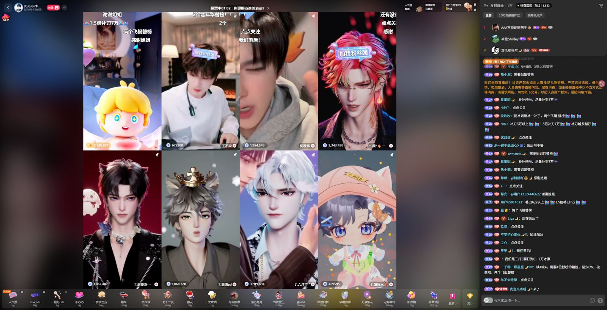

# DouyinEx

抖音网页直播间增强 Userscript：弹幕重绘、画质、礼物屏蔽、PK 真实分数。

## 功能

- **弹幕不掉帧**：Worker + OffscreenCanvas 重绘弹幕，与主线程解耦
- **弹幕悬停**：悬停只暂停鼠标指到的那一条弹幕，同轨道其他弹幕继续滚动；可复读、+1、引用回复
- **弹幕间距**：同轨相邻弹幕的间距随机（56–206px 起步），比原生更松，且不会互相压字
- **自动最高画质**：进入直播间自动切到当前可用的最高档（原画 > 蓝光 > 超清 > 高清 > 标清）
- **屏蔽礼物特效**：调用官方「礼物设置 → 屏蔽礼物特效」
- **屏蔽送礼弹幕**：弹幕画布与右侧聊天列表都不再出现「送出了 ×N」
- **PK 真实分数**：把 `100万+` 之类的缩写替换成精确值，并实时跟随票数刷新
- **悬浮设置框**：停靠在「在线观众」旁，显示真实在线人数，点击展开设置

## 安装

1. 安装 [Tampermonkey](https://www.tampermonkey.net/)
2. 打开 [DouyinEx.user.js](./DouyinEx.user.js)，点击安装
3. 进入 https://live.douyin.com/ 任意直播间

脚本自带 `@updateURL`，安装后会随仓库 `main` 分支自动更新。

## 使用

右下角「弹幕增强」悬浮框点击展开面板，可分别开关：

- 自动最高画质
- 屏蔽礼物特效
- 屏蔽送礼弹幕
- PK 真实分数

悬停任意弹幕只暂停这一条（其余弹幕照常滚动），并弹出「回复 / +1 / 复制」操作。

## 兼容性

- 仅在 `https://live.douyin.com/*` 生效
- 需要浏览器支持 `Worker` + `OffscreenCanvas`（Chrome / Edge 105+）
- 抖音页面结构变化时脚本会静默回退到原生弹幕，不影响正常观看

## 截图

## 说明

仅供个人学习与前端技术交流使用，请遵守抖音平台规则。